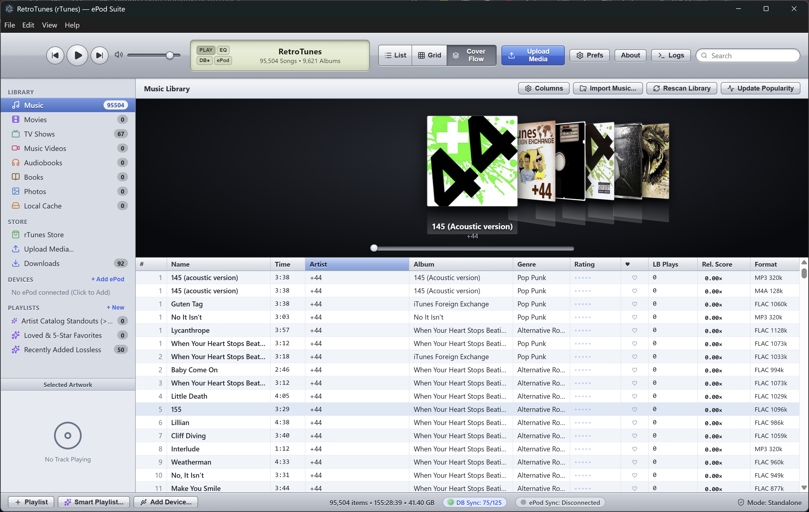
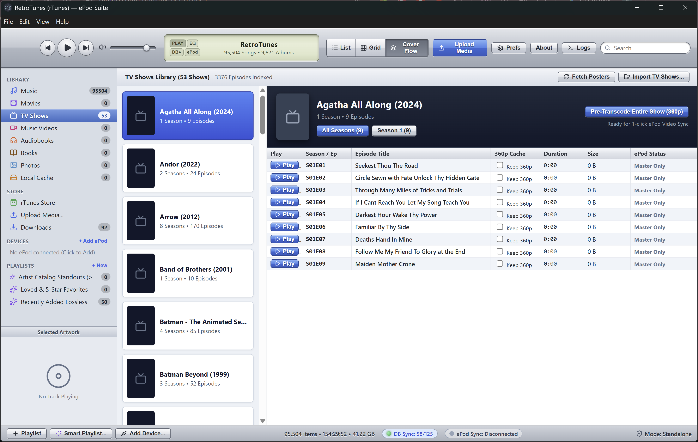
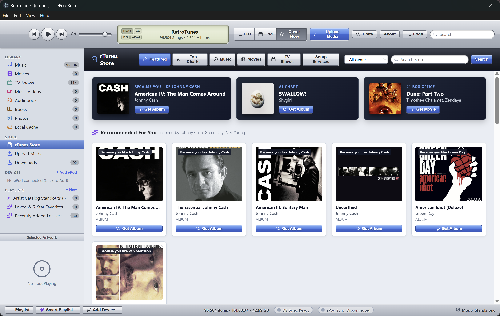
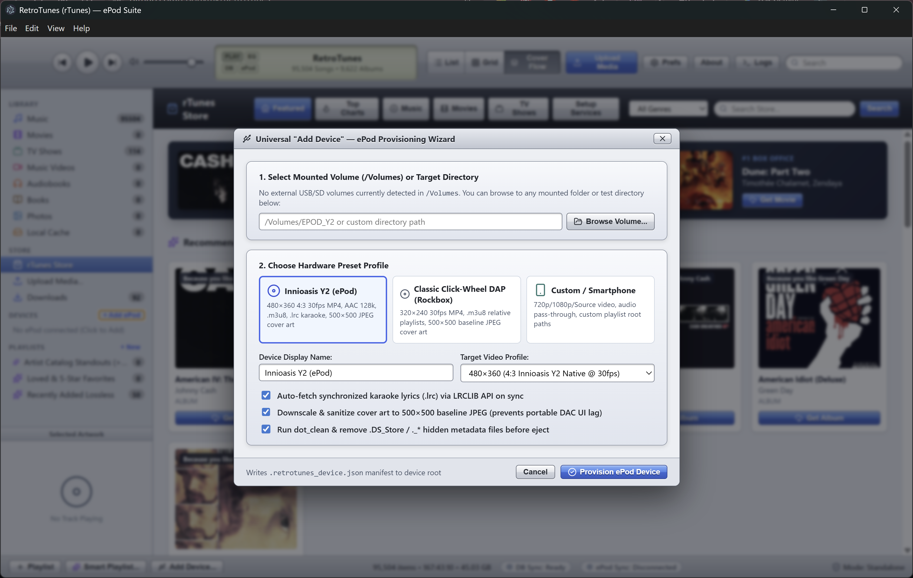
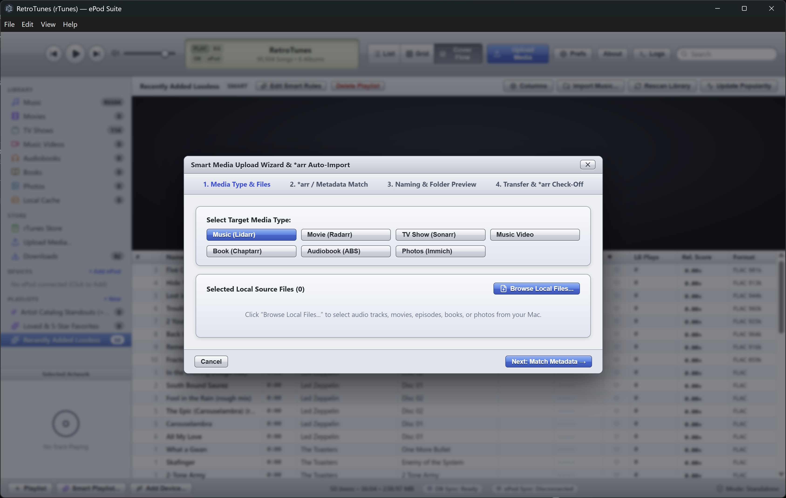

# RetroTunes (`rTunes`) — ePod Suite

**A nostalgic, late-2000s iTunes 9-inspired desktop media manager, self-hosted `*arr` storefront, and automated Digital Audio Player (DAP) sync suite.**

RetroTunes brings back tactile Cover Flow browsing, smart playlists, and one-click portable device syncing—re-engineered for modern self-hosted NAS libraries (NFS/SMB), lossless collections, and dedicated offline players like the **Innioasis Y2 (Stock & Y2 Reborn)** and **Rockbox** click-wheel DAPs.

> **Current Build Status:** RetroTunes currently operates exclusively in **Standalone Mode** (`Mode: Standalone` in the bottom-right status bar). **Authentik and SSO authentication are visible in the UI/configuration but are not yet functional.**

---

## Core Features

### 1. Classic Desktop Experience & Local SQLite Caching
* **Authentic Retro UI:** Brushed-metal and aqua interface featuring LCD playback/sync telemetry, `List`, `Grid`, and 3D `Cover Flow` views, and dynamic smart playlists (*Artist Catalog Standouts*, *Loved & 5-Star Favorites*, *Recently Added Lossless*).
* **Fast Network Library Indexing:** Uses a local SQLite FTS5 cache (`better-sqlite3`) in front of NFS/SMB master shares so libraries with 95,000+ tracks and thousands of TV episodes browse and filter instantaneously without hammering network storage.
* **Two-Way ListenBrainz & Rating Sync:** Syncs 5-star track ratings, `♥` Loved flags, play counts (`LB Plays`), and artist-relative popularity scores (`Rel. Score`).

### 2. Universal ePod Provisioning & DAP Sync Engine
* **Hardware Preset Profiles:** Writes a `.retrotunes_device.json` manifest to USB Mass Storage volumes (`/Volumes` or custom mount paths) and supports MTP device workflows.
* **DAP-Safe Sanitization:**
  * Downscales and converts embedded/folder cover art to **`500×500` baseline JPEG** to prevent portable DAC/DAP UI lag or progressive-JPEG decode crashes.
  * Automatically fetches synchronized karaoke lyrics (`.lrc`) via the **LRCLIB API** during sync.
  * Generates portable relative `.m3u8` playlists and cleans hidden metadata files (`dot_clean`, `.DS_Store`, `._*`) prior to eject.

### 3. Pre-Transcoding Video Pipeline
* **One-Click Show & Episode Caching:** Queue entire seasons or individual episodes (`Keep 360p`) for background transcoding via **HandBrakeCLI / FFmpeg** so video libraries are pre-staged for rapid 4:3 DAP transfers.

### 4. Self-Hosted `rTunes Store` & Smart `*arr` Upload Wizard
* **Request Storefront:** Browse Featured releases, Top Charts, and taste-based recommendations (*"Recommended For You"*) with one-click `Get Album` and `Get Movie` triggers connected to your self-hosted stack.
* **4-Step Smart Media Upload Wizard:** Ingest local media directly into your server pipeline (`1. Media Type & Files` → `2. *arr / Metadata Match` → `3. Naming & Folder Preview` → `4. Transfer & *arr Check-Off`).

---

## Supported Device Profiles

| Profile | Target Resolution & Video | Audio & Playlists | Cover Art & Extras |
| :--- | :--- | :--- | :--- |
| **Innioasis Y2 (`ePod`)** | `480×360` (4:3 Native @ 30fps MP4) | AAC 128k / Pass-through, `.m3u8` | `500×500` baseline JPEG, `.lrc` karaoke lyrics |
| **Classic Click-Wheel (Rockbox)** | `320×240` (30fps MP4) | Lossless/MP3/AAC, relative `.m3u8` | `500×500` baseline JPEG, dotfile cleanup |
| **Custom / Smartphone** | `720p` / `1080p` / Source | Audio pass-through, custom root paths | Configurable manifest & playlist roots |

---

## Self-Hosted Ecosystem Integrations

Configure endpoints and API keys under **Store → Setup Services** or **Prefs**:

| Media / Service Type | Integrated Backend | Status |
| :--- | :--- | :--- |
| **Music** | Lidarr, ListenBrainz, LRCLIB | Active |
| **Movies** | Radarr | Active |
| **TV Shows** | Sonarr | Active |
| **Books & Audiobooks** | Chaptarr, Audiobookshelf (ABS) | Active |
| **Photos** | Immich | Active |
| **Authentication** | Standalone Mode | Active |
| **Authentication** | Authentik SSO | **Not Functional (WIP)** |

---

## Roadmap: `rTunes` Companion Docker Server

Upcoming releases will introduce a dedicated self-hosted **RetroTunes Companion Docker container** designed to turn `rTunes` into a unified, multi-PC ecosystem:

* **Centralized API Key & Service Vault:** Store all Lidarr, Radarr, Sonarr, Chaptarr, Audiobookshelf, Immich, and ListenBrainz credentials once inside the Docker backend—connect any `rTunes` desktop client to the container without configuring secrets per machine.
* **Direct Share Access & Live Push Updates:** Mount your NAS media shares directly to the container so it automatically detects file additions or metadata changes, updates the master database, and pushes live delta updates to all connected clients.
* **Server-Side Music Streaming & Offloaded Transcoding:** Stream music directly from the container to desktop clients and offload heavy FFmpeg / HandBrakeCLI DAP video and audio transcoding from client PCs to the server.
* **Cross-PC Playlist & Library Sync:** Keep standard playlists, smart playlists, ratings, and playback state continuously synchronized across multiple computers—delivering a seamless, multi-device iTunes-style workflow.
* **Functional Authentik / OIDC Integration:** Complete SSO login support paired with the companion server backend.

---

## Screenshots

| Music Library & Cover Flow | TV Shows & 360p Pre-Transcode |
| :---: | :---: |
|  |  |

| `rTunes Store` Request Front | Universal ePod Provisioning |
| :---: | :---: |
|  |  |

| Smart `*arr` Upload Wizard | |
| :---: | :---: |
|  | |

---

## Getting Started

### Prerequisites
* **Node.js** (v20+ LTS) & `npm`
* **FFmpeg** and **HandBrakeCLI** installed and available in system `PATH` (for 360p/240p DAP video transcoding)
* **C++ Build Tools** (required to compile `better-sqlite3` native bindings):
  * **Windows:** Visual Studio Build Tools (*Desktop development with C++* workload)
  * **macOS:** Xcode Command Line Tools (`xcode-select --install`)
  * **Linux:** `build-essential` and `python3`

### Installation & Development
```bash
git clone [https://github.com/edonvmk/RetroTunes.git](https://github.com/edonvmk/RetroTunes.git)
cd RetroTunes
git checkout feat/omni-platform
npm install
npm run dev
